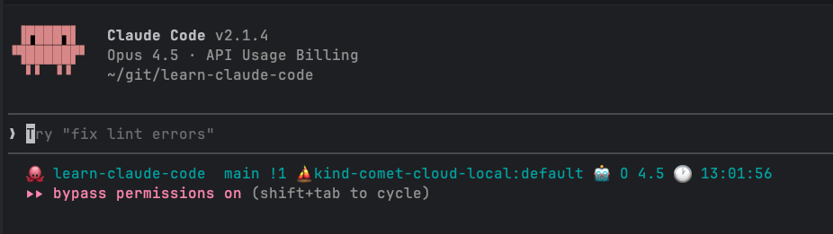

# The Slash commands

Claude code has a lot fo useful slash commands. You can also create your own slash commands.

## Built-in Slash Commands

Here some commands I have used at least once in alphabetical order. Note, that this is not a comprehensive list. You may
find other commands useful, so explore on your own. Just type `/` and start scrolling down. Alternatively, check all the
slash commands in the docs: todos

### clear

The `/clear` command is useful if you finished a conversation, and you want to start a fresh one.

It also has an alias called `/reset`

Alternatively, you can exit and start again but `/clear` is faster.

### Compact

OK. I was lying. I'll write about commands I don't use too. The `/compact` command summarizes the conversation and
replace the current context with the summary. Claude Code will do it automatically when the context window gets full,
but at this point the context might contain a lot of junk and the auto compaction can keep less important stuff and
throw away some useful stuff.

The nice thing about the `/compact` command is that you can provide instructions, which Claude will take into account
when
compacting.

In general, when I work on important projects I ask Claude to keep track of progress in plan files or issue tracker. If
the context gets filled up and I don't want to wait for the auto-compaction, which or may not retain the most important
insights then I just exit and start again pointing to the plan file.

## Context

The `/context` command is super-cool and very useful if you engage in active cintext engineering and try to figure
what's going on in there. Here is part of the output.

```
❯ /context 
  ⎿   Context Usage
     ⛁ ⛀ ⛁ ⛁ ⛁ ⛁ ⛁ ⛁ ⛁ ⛁   claude-opus-4-5-20251101 · 53k/200k tokens (27%)
     ⛁ ⛁ ⛁ ⛁ ⛁ ⛁ ⛁ ⛁ ⛁ ⛁   ⛁ System prompt: 3.1k tokens (1.6%)
     ⛁ ⛁ ⛁ ⛁ ⛁ ⛁ ⛀ ⛀ ⛀ ⛶   ⛁ System tools: 16.8k tokens (8.4%)
     ⛶ ⛶ ⛶ ⛶ ⛶ ⛶ ⛶ ⛶ ⛶ ⛶   ⛁ MCP tools: 31.9k tokens (15.9%)
     ⛶ ⛶ ⛶ ⛶ ⛶ ⛶ ⛶ ⛶ ⛶ ⛶   ⛁ Custom agents: 369 tokens (0.2%)
     ⛶ ⛶ ⛶ ⛶ ⛶ ⛶ ⛶ ⛶ ⛶ ⛶   ⛁ Memory files: 1.1k tokens (0.6%)
     ⛶ ⛶ ⛶ ⛶ ⛶ ⛶ ⛶ ⛶ ⛶ ⛶   ⛁ Messages: 8 tokens (0.0%)
     ⛶ ⛶ ⛶ ⛶ ⛶ ⛶ ⛶ ⛝ ⛝ ⛝   ⛶ Free space: 102k (50.9%)
     ⛝ ⛝ ⛝ ⛝ ⛝ ⛝ ⛝ ⛝ ⛝ ⛝   ⛝ Autocompact buffer: 45.0k tokens (22.5%)
     ⛝ ⛝ ⛝ ⛝ ⛝ ⛝ ⛝ ⛝ ⛝ ⛝ 

```

It prints a lot of more detailed information about each element. But, let's analyze this context at a high-level.

The context window size is 200k tokens. The first line shows that overall 53k (27%) is currently used:

```
⛁ ⛀ ⛁ ⛁ ⛁ ⛁ ⛁ ⛁ ⛁ ⛁   claude-opus-4-5-20251101 · 53k/200k tokens (27%)
```

It may seem like we have about 3/4 of the context window available, but actually 45k tokens (22.5%) is reserved by
Claude Code for its Autocompact buffer.

**Why the autocompact buffer exists:** The context window limit applies to input + output tokens combined (see
[Claude docs](https://platform.claude.com/docs/en/build-with-claude/context-windows)). When autocompaction triggers,
the model needs to generate a summary. Without reserved space, a full context window would leave no room for the
model to write any output - including the compacted summary itself. This means that the compacted context can't exceed
45k tokens.

This means, that right off the bat we have just about half of the context window available for our conversation with
Claude:

```
     ⛶ ⛶ ⛶ ⛶ ⛶ ⛶ ⛶ ⛝ ⛝ ⛝   ⛶ Free space: 102k (50.9%)
```

Let's see what else is taking space besides the auto compct buffer. First, we have non-negotiable system prompt + system
tools. They take about 20k tokens or 10% of the overall context window.

```
     ⛁ ⛁ ⛁ ⛁ ⛁ ⛁ ⛁ ⛁ ⛁ ⛁   ⛁ System prompt: 3.1k tokens (1.6%)
     ⛁ ⛁ ⛁ ⛁ ⛁ ⛁ ⛀ ⛀ ⛀ ⛶   ⛁ System tools: 16.8k tokens (8.4%)
```

Next, we have the MCP tools that take a significant chunk of almost 32k tokens (15.9%)

```
     ⛶ ⛶ ⛶ ⛶ ⛶ ⛶ ⛶ ⛶ ⛶ ⛶   ⛁ MCP tools: 31.9k tokens (15.9%)
```

Let's dig a little deeper and look at the actual MCP tools I have installed (Linear, Notion and Datadog). Each of MCP
server exposes multiple tools and each one has its own cost.

```
     MCP tools · /mcp
     └ mcp__linear__list_comments: 103 tokens
     └ mcp__linear__create_comment: 153 tokens
     └ mcp__linear__list_cycles: 155 tokens
     └ mcp__linear__get_document: 103 tokens
     └ mcp__linear__list_documents: 411 tokens
     └ mcp__linear__create_document: 206 tokens
     └ mcp__linear__update_document: 224 tokens
     └ mcp__linear__get_issue: 145 tokens
     └ mcp__linear__list_issues: 567 tokens
     └ mcp__linear__create_issue: 792 tokens
     └ mcp__linear__update_issue: 927 tokens
     └ mcp__linear__list_issue_statuses: 106 tokens
     └ mcp__linear__get_issue_status: 162 tokens
     └ mcp__linear__list_issue_labels: 241 tokens
     └ mcp__linear__create_issue_label: 243 tokens
     └ mcp__linear__list_projects: 454 tokens
     └ mcp__linear__get_project: 107 tokens
     └ mcp__linear__create_project: 454 tokens
     └ mcp__linear__update_project: 465 tokens
     └ mcp__linear__list_project_labels: 219 tokens
     └ mcp__linear__list_teams: 349 tokens
     └ mcp__linear__get_team: 109 tokens
     └ mcp__linear__list_users: 123 tokens
     └ mcp__linear__get_user: 113 tokens
     └ mcp__linear__search_documentation: 126 tokens
     └ mcp__datadog__list_ci_pipelines: 295 tokens
     └ mcp__datadog__get_pipeline_fingerprints: 249 tokens
     └ mcp__datadog__get_logs: 366 tokens
     └ mcp__datadog__get_logs_field_values: 351 tokens
     └ mcp__datadog__get_teams: 239 tokens
     └ mcp__datadog__get_metrics: 426 tokens
     └ mcp__datadog__get_metric_fields: 211 tokens
     └ mcp__datadog__get_metric_field_values: 213 tokens
     └ mcp__datadog__list_metrics: 237 tokens
     └ mcp__datadog__list_service_definitions: 239 tokens
     └ mcp__datadog__get_service_definition: 199 tokens
     └ mcp__datadog__list_monitors: 323 tokens
     └ mcp__datadog__list_slos: 297 tokens
     └ mcp__notion__search: 1.5k tokens
     └ mcp__notion__fetch: 302 tokens
     └ mcp__notion__notion-create-pages: 2.0k tokens
     └ mcp__notion__notion-update-page: 2.0k tokens
     └ mcp__notion__notion-move-pages: 611 tokens
     └ mcp__notion__notion-duplicate-page: 220 tokens
     └ mcp__notion__notion-create-database: 5.8k tokens
     └ mcp__notion__notion-update-database: 6.0k tokens
     └ mcp__notion__notion-create-comment: 1.6k tokens
     └ mcp__notion__notion-get-comments: 108 tokens
     └ mcp__notion__notion-get-teams: 229 tokens
     └ mcp__notion__notion-get-users: 452 tokens
     └ mcp__notion__notion-get-self: 79 tokens
     └ mcp__notion__notion-get-user: 120 tokens
```

This is very surprising to see many tokens each tool requires. Just these five Notion tools take about 17k tokens.

```
     └ mcp__notion__notion-create-pages: 2.0k tokens
     └ mcp__notion__notion-update-page: 2.0k tokens
     └ mcp__notion__notion-create-database: 5.8k tokens
     └ mcp__notion__notion-update-database: 6.0k tokens
     └ mcp__notion__notion-create-comment: 1.6k tokens
```

**Key insight:** MCP tools can consume significant context before you even start. If you don't need certain MCP servers
for a session, disabling
them can free up substantial context space.

### Cost

The `/cost` command gives me a breakdown of cost per model and a sense of the work done as far as lines of code (added,
removed)

```
❯ /cost 
  ⎿  Total cost:            $2.69
     Total duration (API):  5m 12s
     Total duration (wall): 9h 39m 12s
     Total code changes:    10 lines added, 1 line removed
     Usage by model:
             claude-haiku:  42.1k input, 790 output, 0 cache read, 11.9k cache write ($0.0609)
          claude-opus-4-5:  3.4k input, 10.7k output, 1.7m cache read, 235.3k cache write, 1 web search ($2.63)
```

You can see that in about five minutes of actual API time I accrued cost of $2.69, most of it from Claude Opus 4.5.

In general, there is a big difference in costs between different models: Haiku, Sonnet and Opus. We will discuss model
selection and cost in depth later. Here, I just wanted to show the slash command.

### Config

The `/config` or its alias `/settings` gives you the option to configure the way Claude Code operates. It updates your
`.claude/settings.json` file. For example, you can disable auto-compact, the default permissions mode or many other
settings. Check them out for yourself.

```
❯ /config
────────────────────────────────────────────────────────────────────────────
  Settings:  Status   Config   Usage  (←/→ or tab to cycle)


  Configure Claude Code preferences

  ❯ Auto-compact                              true
    Show tips                                 true
    Thinking mode                             true
    Prompt suggestions                        true
    Rewind code (checkpoints)                 true
    Verbose output                            false
    Terminal progress bar                     true
    Default permission mode                   Accept edits
    Respect .gitignore in file picker         true
    Auto-update channel                       latest
    Theme                                     Dark mode
    Notifications                             Auto
    Output style                              default
    Language                                  Default (English)
    Editor mode                               normal
    Model                                     opus
    Auto-connect to IDE (external terminal)   false
    Claude in Chrome enabled by default       true

  Enter/Space to change · escape to cancel
```

You can also switch to the `Status` tab directly from the `Config` screen if you wish.

### Status

The status command gives you some useful overview information about your Claude Code settings.

```
❯ /status

──────────────────────────────────────────────────────────────────────────────
  Settings:  Status   Config   Usage  (←/→ or tab to cycle)


  Version: 2.1.3
  Session name: /rename to add a name
  Session ID: 4eb36de6-c9f2-4c22-8ad3-a8232ea6c078
  cwd: /Users/gigi
  Auth token: none
  API key: /login managed key
  Organization: Sayfan AI
  Email: the.gigi@gmail.com

  Model: opus (claude-opus-4-5-20251101)
  MCP servers: notion ✔, linear ✔, datadog ✔
  Memory: user (.claude/CLAUDE.md)
  Setting sources: User settings, Shared project settings, Project local settings
  escape to cancel
```

As mentioned earlier it is in the same interface as `Config` and you can switch to Config or Usage using arrows keys or
tab.

### Status Line

The `/statusline` command lets you set up a status line that appears below the prompt filed in Claude Code. It can
generate it automatically based on your PS1 shell prompt. Here is what it generates by default for me (maybe different
for you):

```
  [12:49:28] /Users/gigi/git/learn-claude-code (main) Opus 4.5  
```

This is how it shows up in ~/.claude/settings.json

```
  "statusLine": {
    "type": "command",
    "command": "input=$(cat); cwd=$(echo \"$input\" | jq -r '.workspace.current_dir'); model=$(echo \"$input\" | jq -r '.model.display_name'); branch=$(cd \"$cwd\" 2>/dev/null && git branch --show-current 2>/dev/null); timestamp=$(date +'[%H:%M:%S]'); if [ -n \"$branch\" ]; then printf '%s %s (%s) %s' \"$timestamp\" \"$cwd\" \"$branch\" \"$model\"; else printf '%s %s %s' \"$timestamp\" \"$cwd\" \"$model\"; fi"
  }
```

But, I have a fancy shell prompt based on PowerLeve10k theme and custom emojis for special directories. So, I asked
Claude to mimic it, and it created a complex shell script. The script extracts a lot of information like directory (with emoji replacement logic), Kubernetes
cluster, Git status, AWS profile, Python virtualenv, time and the current model and eventually assembles a single status line:

```
❯ cat ~/.claude/statusline-command.sh
#!/bin/bash

# Powerlevel10k-inspired status line for Claude Code
# Mirrors key elements from ~/.p10k.zsh configuration

# Read JSON input
input=$(cat)

# Extract values from JSON input
cwd=$(echo "$input" | jq -r '.workspace.current_dir')
model_name=$(echo "$input" | jq -r '.model.display_name')
output_style=$(echo "$input" | jq -r '.output_style.name')

# Change to the working directory for git commands
cd "$cwd" 2>/dev/null || true

# ============= DIRECTORY =============
# Mimics P10K dir segment with brain emoji for ~/git/prplx directories
dir_part=""
if [[ "$cwd" == "$HOME" ]]; then
    dir_part="🏠"
elif [[ "$cwd" == "$HOME/git/prplx"* ]]; then
    # Extract the path after ~/git/prplx/
    relative_path="${cwd#$HOME/git/prplx/}"
    if [[ "$relative_path" == "" ]]; then
        dir_part="🧠 prplx"
    else
        # Show component after ~/git/prplx/ with brain emoji
        # Truncate long paths
        if [[ ${#relative_path} -gt 30 ]]; then
            dir_part="🧠 …/$(basename "$cwd")"
        else
            dir_part="🧠 $relative_path"
        fi
    fi
elif [[ "$cwd" == "$HOME/git"* ]]; then
    # Extract the path after ~/git/
    relative_path="${cwd#$HOME/git/}"
    if [[ "$relative_path" == "" ]]; then
        dir_part="🐙 git"
    else
        # Show first component after ~/git/ with octopus emoji
        first_component=$(echo "$relative_path" | cut -d'/' -f1)
        remaining_path=$(echo "$relative_path" | cut -d'/' -f2-)
        if [[ "$remaining_path" == "$first_component" ]]; then
            dir_part="🐙 $first_component"
        else
            # Truncate long paths
            if [[ ${#remaining_path} -gt 30 ]]; then
                dir_part="🐙 $first_component/…/$(basename "$cwd")"
            else
                dir_part="🐙 $first_component/$remaining_path"
            fi
        fi
    fi
else
    # For other directories, show basename with folder icon
    dir_part="📁 $(basename "$cwd")"
fi

# ============= GIT STATUS =============
# Mimics P10K vcs segment with comprehensive git information
git_part=""
if git rev-parse --git-dir >/dev/null 2>&1; then
    # Get branch name
    branch=$(git symbolic-ref --short HEAD 2>/dev/null || git describe --tags --exact-match 2>/dev/null || git rev-parse --short HEAD 2>/dev/null)

    # Truncate long branch names (P10K style)
    if [[ ${#branch} -gt 32 ]]; then
        branch="${branch:0:12}…${branch: -12}"
    fi

    git_part="  $branch"

    # Get git status information (skip optional locks per CLAUDE.md)
    if git_status=$(GIT_OPTIONAL_LOCKS=0 git status --porcelain --branch 2>/dev/null); then
        # Count changes (mimics P10K indicators)
        staged=$(echo "$git_status" | grep -c "^[AMDRC]" 2>/dev/null || echo 0)
        unstaged=$(echo "$git_status" | grep -c "^.[MD]" 2>/dev/null || echo 0)
        untracked=$(echo "$git_status" | grep -c "^??" 2>/dev/null || echo 0)

        # Check for commits ahead/behind
        ahead_behind=$(echo "$git_status" | head -1 | grep -oE '\[ahead [0-9]+\]|\[behind [0-9]+\]' 2>/dev/null)

        # Build git status indicators (P10K style)
        indicators=""
        if [[ "$ahead_behind" =~ ahead\ ([0-9]+) ]]; then
            indicators+=" ⇡${BASH_REMATCH[1]}"
        fi
        if [[ "$ahead_behind" =~ behind\ ([0-9]+) ]]; then
            indicators+=" ⇣${BASH_REMATCH[1]}"
        fi
        [[ $staged -gt 0 ]] && indicators+=" +$staged"
        [[ $unstaged -gt 0 ]] && indicators+=" !$unstaged"
        [[ $untracked -gt 0 ]] && indicators+=" ?$untracked"

        git_part+="$indicators"
    fi
fi

# ============= PYTHON VIRTUALENV =============
# Mimics P10K virtualenv segment
venv_part=""
if [[ -n "$VIRTUAL_ENV" ]]; then
    venv_name=$(basename "$VIRTUAL_ENV")
    venv_part=" 🐍 $venv_name"
fi

# ============= DIRENV =============
# Mimics P10K direnv segment
direnv_part=""
if [[ -n "$DIRENV_DIR" ]]; then
    direnv_part=" 📦"
fi

# ============= KUBERNETES CONTEXT =============
# Mimics P10K kubecontext segment
k8s_part=""
if command -v kubectl >/dev/null 2>&1; then
    context=$(kubectl config current-context 2>/dev/null)
    if [[ -n "$context" ]]; then
        namespace=$(kubectl config view --minify --output 'jsonpath={..namespace}' 2>/dev/null)
        [[ -z "$namespace" ]] && namespace="default"
        k8s_part=" ⛵ $context:$namespace"
    fi
fi

# ============= AWS ROLE/PROFILE =============
# Mimics P10K aws_role segment
aws_part=""
if [[ -n "$AWS_PROFILE" ]]; then
    aws_part=" ☁️ $AWS_PROFILE"
elif [[ -n "$AWS_ROLE_ARN" ]]; then
    role_name=$(echo "$AWS_ROLE_ARN" | grep -oE '[^/]+$')
    aws_part=" ☁️ $role_name"
fi

# ============= TIME =============
# Mimics P10K time segment (24h format as per config)
time_part=" 🕐 $(date +%H:%M:%S)"

# ============= MODEL INFO =============
# Claude Code specific - show current model
model_part=""
if [[ -n "$model_name" && "$model_name" != "null" ]]; then
    # Shorten model name for display
    short_model=$(echo "$model_name" | sed 's/Claude //' | sed 's/Sonnet/S/' | sed 's/Opus/O/' | sed 's/Haiku/H/')
    model_part=" 🤖 $short_model"
fi

# ============= OUTPUT STYLE =============
# Claude Code specific - show output style if not default
style_part=""
if [[ -n "$output_style" && "$output_style" != "null" && "$output_style" != "default" ]]; then
    style_part=" 📝 $output_style"
fi

# ============= ASSEMBLE STATUS LINE =============
# Combine all parts
status_line="$dir_part$git_part$venv_part$direnv_part$k8s_part$aws_part$model_part$style_part$time_part"

# Output with cyan color (mimics P10K dimmed appearance in Claude)
printf '\033[36m%s\033[0m' "$status_line"
```

Then, in settings.json it simply sets it as the "statusline" command.

```

```

Here is what my Claude Code status line looks like:



There are many more slash commands that are relevant for other areas like agents, skills, hooks and plugins that we will mention in other sections. 

Alright, let's look at custom commands.

## Creating Custom Slash Commands
